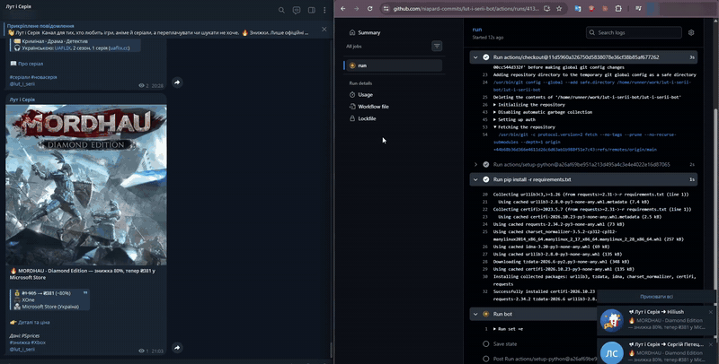

# Telegram channel that runs itself

[](https://github.com/niapard-commits/telegram-autoposting-bot/actions/workflows/tests.yml)


An automation that publishes a Ukrainian Telegram channel about games, anime and
series on a schedule. Nobody touches it day to day. It runs on **GitHub Actions**,
so there is no server to pay for or maintain. It pulls data from public APIs,
writes the posts, adds cover images and publishes them. Extra workflows produce
YouTube Shorts and Threads posts from the same data.

<p align="center"></p>

> This is a portfolio copy of a private production repository. It has no
> keys, tokens, database or third-party music, and the scheduled workflows are
> moved to [`examples/workflows`](examples/workflows) so they don't run here.
> Post texts are in Ukrainian.

## What it publishes

| Task | Source | Post |
|---|---|---|
| `deals` | CheapShark | Game discounts from 50%, only trusted stores, no repeats for 14 days |
| `free` | GamerPower + Steam | New free PC giveaways with cover, screenshots and genres |
| `releases` | Wikipedia release calendar + Steam popularity | "Out today" for notable PC / PS / Xbox releases, plus a weekly releases post |
| `consoles` | PSprices, PlayStation Blog, Xbox Wire | PS Store and Microsoft Store deals in UAH, PS Plus, Game Pass |
| `anime` | AniList | Cards for the most popular new episodes |
| `series` | TMDB, TVMaze | Series cards with Ukrainian dub info |
| `dubs` | Public Telegram channels of dub teams | Daily digest of new Ukrainian dubs, summarised by AI |
| `weekly` | Own data | Friday "week in review" |

Prices are converted to UAH using the National Bank of Ukraine exchange rate.

## How it works

```
GitHub Actions (cron) ──► python -m lutserii <task>
                              │
         sources/  ──────────►│ fetch: CheapShark, Steam, AniList, TMDB, ...
         posts.py  ──────────►│ build text + images (HTML for Telegram)
         ai.py     ──────────►│ optional AI editor (Claude or Gemini) with guard rails
         db.py     ──────────►│ SQLite: what was already posted
         telegram.py ────────►│ sendMessage / sendPhoto / media groups
                              ▼
                       Telegram channel
```

- **State without a server.** Everything already published is stored in
  SQLite. The workflow commits the database back to the repository after each
  run, so the next run remembers what was posted.
- **No duplicates, sensible limits.** Per-run and per-day caps for every post
  type, and a "don't repeat this title for N days" rule.
- **AI with guard rails.** Descriptions can be rewritten by Claude or Gemini, but
  every answer is checked. It must contain no links, no @mentions and no numbers
  that are not in the source data. If the check fails, the bot falls back to a
  template text. Several Gemini keys are rotated
  when one hits its quota.
- **Dry run.** Every task can run in preview mode: posts go to the log or to a
  private preview chat instead of the channel.
- **Shorts and Threads.** `scripts/` renders vertical videos from the latest posts
  and uploads them to YouTube. It also drafts Threads posts and sends them to
  Telegram for review before publishing.

## Tests

```bash
pip install -r requirements-dev.txt numpy pillow
pytest -q
```

272 tests run offline. They include golden-file tests that catch any accidental
change in how a post looks. GitHub Actions runs them on every push.

## Run it

1. Create a bot with [@BotFather](https://t.me/BotFather) and add it to your
   channel as an admin.
2. In your fork, open **Settings → Secrets and variables → Actions** and add
   `TELEGRAM_BOT_TOKEN` and `TELEGRAM_CHAT_ID`. API keys such as `TMDB_API_KEY`
   and `GEMINI_API_KEY` are optional per task.
3. Copy `examples/workflows/post.yml` to `.github/workflows/` and run it from the
   **Actions** tab, first with `dry_run` enabled.

Locally:

```bash
pip install -r requirements.txt
TELEGRAM_BOT_TOKEN=... TELEGRAM_CHAT_ID=@your_channel python -m lutserii all --dry-run
```

To render Shorts, download the free [Inter](https://rsms.me/inter/) font into
`assets/fonts/` and add your own music to `assets/music/`.

---

**Need a channel or social account that posts by itself?** Order or ask a question via [my Fiverr gig](https://www.fiverr.com/serhii_bots/build-a-custom-python-telegram-bot).
